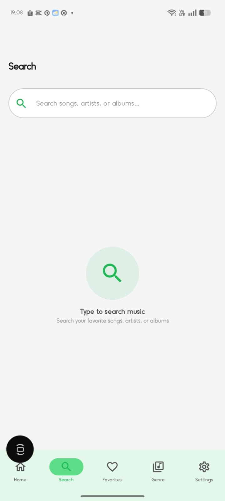

# 🎵 NexusSpace

# <p align="center">🎵 NexusSpace</p>

<p align="center">
  Aplikasi musik Android modern yang dibangun menggunakan
  <strong>Kotlin</strong>, <strong>Jetpack Compose</strong>, dan <strong>Deezer API</strong>.
</p>

---

## 📱 Fitur Utama

<p align="center">
  
  
  
  
</p>

---

## 📖 Tentang Project

**NexusSpace** adalah aplikasi musik berbasis Android yang memungkinkan pengguna menjelajahi berbagai lagu, album, dan artis melalui Deezer API.

Aplikasi ini dikembangkan dengan antarmuka modern menggunakan Jetpack Compose, navigasi yang intuitif, serta dukungan tema gelap dan terang untuk memberikan pengalaman penggunaan yang nyaman.

NexusSpace dibuat sebagai project tugas sekolah sekaligus penerapan pembelajaran pengembangan aplikasi mobile menggunakan Kotlin.

---

## 📱 Fitur Utama

- 🏠 **Halaman Beranda** — Menampilkan lagu trending, album populer, dan artis teratas dari Deezer Chart.
- 🔍 **Pencarian Musik** — Mencari lagu, artis, dan album secara real-time.
- 🎤 **Detail Artis** — Menampilkan profil artis beserta lagu-lagu terbaiknya.
- 💿 **Detail Album** — Menampilkan cover album dan daftar lagu lengkap.
- 🎧 **Music Preview** — Memutar preview musik dengan kontrol play dan pause.
- 🌙 **Dark / Light Mode** — Mengubah tema aplikasi melalui halaman Pengaturan.
- 🌐 **Multi Bahasa** — Mendukung Bahasa Indonesia dan English.
- 📐 **Rotasi Layar** — Antarmuka tetap stabil dan dapat di-scroll saat layar diputar.
- ✨ **Shimmer Loading** — Efek loading modern untuk meningkatkan pengalaman pengguna.

---

## 🛠️ Tech Stack

| Teknologi | Kegunaan |
|---|---|
| Kotlin | Bahasa pemrograman utama |
| Jetpack Compose | Toolkit UI modern untuk Android |
| Navigation Compose | Navigasi antarhalaman |
| Retrofit | HTTP client untuk komunikasi API |
| Gson | Parsing data JSON |
| OkHttp | Networking dan HTTP logging |
| Coil | Memuat gambar dari URL |
| ViewModel | Mengelola state dan logika UI |
| StateFlow | Mengelola perubahan state UI |
| Deezer API | Sumber data musik |
| AppCompat | Mendukung pengaturan bahasa dinamis |

---

## 🗂️ Struktur Project

```text
NexusSpace/
│
├── app/
│   └── src/
│       └── main/
│           └── java/
│               └── com/sandya/nexusspace/
│                   │
│                   ├── data/
│                   │   ├── model/
│                   │   │   └── Data class
│                   │   ├── remote/
│                   │   │   └── API Service
│                   │   └── repository/
│                   │       └── Repository Layer
│                   │
│                   ├── ui/
│                   │   ├── components/
│                   │   │   └── Reusable UI Components
│                   │   ├── navigation/
│                   │   │   └── Navigation Graph
│                   │   ├── screen/
│                   │   │   └── Application Screens
│                   │   ├── theme/
│                   │   │   └── Color, Typography, Theme
│                   │   ├── viewmodel/
│                   │   │   └── ViewModel Classes
│                   │   └── AppPreferences
│                   │
│                   └── MainActivity.kt
│
├── screenshots/
│   ├── beranda gelap.jpg
│   ├── beranda terang.jpg
│   ├── detail artis.jpg
│   └── pencarian.jpg
│
├── gradle/
├── .gitignore
├── build.gradle.kts
├── gradle.properties
├── gradlew
├── gradlew.bat
├── settings.gradle.kts
└── README.md
```

---

## 🌐 Deezer API

NexusSpace menggunakan **[Deezer API](https://developers.deezer.com/api)** sebagai sumber data musik.

API digunakan untuk mengambil informasi lagu, artis, album, dan hasil pencarian.

### Endpoint yang Digunakan

| Endpoint | Fungsi |
|---|---|
| `GET /chart` | Mengambil data trending lagu, album, dan artis |
| `GET /search?q={query}` | Mencari lagu berdasarkan kata kunci |
| `GET /artist/{id}` | Mengambil detail artis |
| `GET /artist/{id}/top` | Mengambil lagu terpopuler dari artis |
| `GET /album/{id}` | Mengambil detail album beserta tracklist |

> Deezer API digunakan sebagai sumber data musik. Endpoint yang tersedia mengikuti layanan Deezer yang digunakan dalam project.

---

## 🚀 Cara Menjalankan Aplikasi

### Prasyarat

Pastikan perangkat atau komputer sudah memiliki:

- Android Studio
- JDK yang sesuai dengan konfigurasi project
- Android SDK
- Emulator Android atau perangkat Android fisik
- Minimum Android 7.0 (API Level 24)

### Instalasi

1. Clone repository:

   ```bash
   git clone https://github.com/sandygifta-ui/NexusSpace.git
   ```

2. Buka folder project menggunakan Android Studio.

3. Tunggu hingga proses **Gradle Sync** selesai.

4. Hubungkan perangkat Android atau jalankan emulator.

5. Klik tombol **Run ▶** untuk menjalankan aplikasi.

> Tidak memerlukan API key untuk konfigurasi Deezer API yang digunakan dalam project ini.

---

## 📸 Screenshot Aplikasi

### 🏠 Halaman Beranda

| Light Mode | Dark Mode |
|---|---|
|  |  |

### 🔍 Pencarian Musik & 🎤 Detail Artis

| Pencarian Musik | Detail Artis |
|---|---|
|  |  |

---

## 👨‍💻 Developer

<p align="center">
  <strong>Sandya Gifta</strong>
  <br/>
  XII RPL — Tugas Projek Mobile
  <br/>
  November – Desember 2026
</p>

---

## 📄 Lisensi

Project ini dikembangkan untuk keperluan tugas sekolah dan pembelajaran pengembangan aplikasi Android.

Data musik dan informasi terkait disediakan oleh [Deezer](https://www.deezer.com).

NexusSpace merupakan project independen dan tidak berafiliasi secara resmi dengan Deezer.
